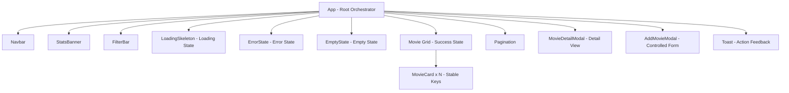

# CineVault — Curated International Cinema & Film Festival Archive

> **Midterm Project — React SPA**  
> A production-grade Single Page Application showcasing over 100 curated cinematic masterpieces and international film festival laureates with simulated asynchronous REST API, multi-criteria filtering, controlled forms, state preservation, and defense readiness.

---

## 🌟 Live Demo & Repository
- **GitHub Repository**: [https://github.com/etozheerassyl/react/tree/main/midterm](https://github.com/etozheerassyl/react/tree/main/midterm)
- **Deployed Application Link**: [https://etozheerassyl.github.io/react/midterm/](https://etozheerassyl.github.io/react/midterm/)

---

## 📋 Table of Contents
1. [Project Overview & Key Requirements](#-project-overview--key-requirements)
2. [Component Architecture & Render Tree](#-component-architecture--render-tree)
3. [State Management & Data Flow Architecture](#-state-management--data-flow-architecture)
4. [Asynchronous Data Flow & Race Condition Handling](#-asynchronous-data-flow--race-condition-handling)
5. [Feature Highlights](#-feature-highlights)
6. [Defense Preparation Guide (4 Points)](#-defense-preparation-guide-4-points)
7. [Live Modification Cheat Sheet](#-live-modification-cheat-sheet)
8. [Installation, Local Development & Deployment](#-installation-local-development--deployment)

---

## 🎯 Project Overview & Key Requirements

| Requirement | Implementation in CineVault | Status |
| :--- | :--- | :---: |
| **Data Source (100+ Records)** | 105 meticulously researched international cinema masterworks initialized in `src/data/initialMovies.js` and persistent via `localStorage`. | ✅ 105 / 100 |
| **Simulated Asynchronous API** | Native `Promises`, realistic delay (`350-500ms`), asynchronous error simulator, and simulated network delay in `src/api/movieApi.js`. | ✅ Implemented |
| **5+ Reusable Components** | Divided into 10 modular components: `Navbar`, `StatsBanner`, `FilterBar`, `MovieCard`, `MovieDetailModal`, `AddMovieModal`, `Pagination`, `LoadingSkeleton`, `EmptyState`, `ErrorState`, `Toast`. | ✅ 10 Components |
| **List & Detail Views** | Responsive grid view + dedicated `MovieDetailModal` with archival synopsis, cast, critical assessment, and festival honors. | ✅ Implemented |
| **Controlled Form** | `AddMovieModal` featuring controlled inputs, per-field real-time validation, disabled submit state, and feedback. | ✅ Implemented |
| **Search, Filter, Sort, Paginate** | Live search, genre filtering, decade filtering, minimum rating, award-winner toggle, 8 sorting options, dynamic pagination with page-size limit. | ✅ Implemented |
| **Correct `useState` & `useEffect`** | Proper dependency arrays, cleanup functions (`let ignore = false;`), and race-condition immunity. | ✅ Implemented |
| **State Handling** | Dedicated visual states for Loading (shimmer skeletons), Error (alert banner with retry), Empty (reset filters CTA), and Success (toast notifications). | ✅ Implemented |
| **No Direct DOM Manipulation** | 100% declarative React state, controlled inputs, and virtual DOM reconciliation. | ✅ Compliant |

---

## 🏗️ Component Architecture & Render Tree



### Component Breakdown
1. **`App.jsx`**: Top-level coordinator. Stores core query state (`filters`, `currentPage`, `limit`), catalog records, selected detail movie ID, and favorites.
2. **`Navbar.jsx`**: Global branding, favorite counter, simulated error toggle (for defense demonstrations), and database reset button.
3. **`StatsBanner.jsx`**: Displays aggregate metrics (total films, matching count, average rating, festival laureates).
4. **`FilterBar.jsx`**: Controlled inputs for search queries, genre dropdown, decade dropdown, rating selector, laureates toggle, and sort orders.
5. **`MovieCard.jsx`**: Individual film presentation with image fallback, rating badge, decade badge, awards banner, and actions to inspect or favorite.
6. **`MovieDetailModal.jsx`**: Deep-dive detail view featuring unabridged synopsis, key cast, curator assessment notes, and awards list.
7. **`AddMovieModal.jsx`**: Controlled modal form with field validation (required fields, valid year ranges, positive runtimes, 0-10 rating).
8. **`Pagination.jsx`**: Reusable navigation with numeric pages, ellipsis trimming, and item counter.
9. **`LoadingSkeleton.jsx`**: Shimmer skeleton layout shown during asynchronous data fetching.
10. **`EmptyState.jsx`**: Friendly fallback with "Reset All Filters" CTA when zero records match query.
11. **`ErrorState.jsx`**: Visual error banner with retry trigger and simulated error toggle.
12. **`Toast.jsx`**: Floating alert for user actions.

---

## 🧠 State Management & Data Flow Architecture

### Where State is Stored and Why

| State Variable | Stored In | Architectural Rationale |
| :--- | :--- | :--- |
| `movies`, `totalCount`, `totalPages`, `stats` | `App.jsx` | Shared data required by `MovieCard` list, `Pagination`, and `StatsBanner`. Lifting state up enables synchronization. |
| `filters`, `currentPage`, `limit` | `App.jsx` | Query parameters drive the primary `useEffect` hook. Changes trigger automated server-style requests. |
| `selectedMovieId` | `App.jsx` | Coordinates whether the `MovieDetailModal` is open and which film to fetch. |
| `isAddModalOpen` | `App.jsx` | Toggled by `Navbar` button and closed by `AddMovieModal`. |
| `favorites` | `App.jsx` + `localStorage` | Global user preference persistent across refreshes. |
| `formData`, `errors`, `isSubmitting` | `AddMovieModal.jsx` | **Colocated State**: Kept inside the form component to avoid polluting parent state and prevent unnecessary re-renders of the main catalog while typing. |
| `imageError` | `MovieCard.jsx` | **Local Component State**: Only relevant to the individual card experiencing an image load error. |
| `movie`, `loading`, `error` (single item) | `MovieDetailModal.jsx` | **Local View State**: Managed inside the modal when inspecting a specific record. |

---

## ⚡ Asynchronous Data Flow & Race Condition Handling

### How API Data Reaches the UI
1. The user interacts with `FilterBar` (e.g. types a search query or changes genre).
2. `FilterBar` invokes `onFilterChange`, updating `filters` state in `App.jsx` and resetting `currentPage` to 1.
3. The change in `filters` triggers the primary `useEffect` in `App.jsx`.
4. `setLoading(true)` displays `LoadingSkeleton`.
5. The asynchronous method `movieApi.getMovies(...)` executes with a simulated network delay.
6. Upon promise resolution, `setMovies`, `setTotalCount`, and `setStats` update in a single batched render pass.
7. `setLoading(false)` swaps the skeleton for the rendered `MovieCard` list.

### Preventing Stale Closures and Race Conditions
When a user types rapidly in a search box, multiple asynchronous requests fire in sequence. If an earlier request finishes *after* a later request, it could overwrite fresh state with stale data.

To prevent this, our `useEffect` uses the **Cleanup Flag Pattern**:

```javascript
useEffect(() => {
  let ignore = false;
  setLoading(true);
  setError(null);

  movieApi.getMovies({ ...filters, page: currentPage, limit })
    .then((res) => {
      // If a newer effect has run, ignore is true and this update is discarded!
      if (!ignore) {
        setMovies(res.data);
        setTotalCount(res.total);
        setLoading(false);
      }
    })
    .catch((err) => {
      if (!ignore) {
        setError(err.message);
        setLoading(false);
      }
    });

  return () => {
    // Cleanup runs before re-running the effect or on unmount
    ignore = true;
  };
}, [filters, currentPage, limit, refreshKey]);
```

---

## 🎓 Defense Preparation Guide (4 Points)

During the defense, examiners test your grasp of fundamental React theory and your own codebase. Here are the precise explanations:

### 1. Component Structure & Render Tree
- **Render Tree**: A hierarchical graph representing parent-child component relationships in JSX (`App` ➔ `FilterBar`, `MovieCard`, etc.).
- When `App` re-renders, React traverses down the render tree and re-evaluates child components unless memoized.

### 2. What Causes a Component to Re-render?
A React component re-renders when:
1. Its internal **state** updates via `useState` setter.
2. Its received **props** change.
3. Its **parent component** re-renders.
4. A **context** it subscribes to changes value.

### 3. State Snapshots and Batching
- **Snapshots**: Every render takes a "snapshot" of state at that moment in time. Inside event handlers, state variables remain constant for the duration of that render pass.
- **Batching**: React 18+ automatically batches multiple state updates (even inside Promises, `setTimeout`, or native event handlers) into a single re-render, eliminating unnecessary intermediate paints.

### 4. Reconciliation, Component Identity, and Keys
- **Reconciliation**: React's algorithm (Fiber) that compares the new Virtual DOM tree with the previous one (diffing).
- **Stable Keys**: In `displayedMovies.map((movie) => <MovieCard key={movie.id} ... />)`, we use `movie.id` (never array index). Stable keys allow React to preserve component identity, maintain local state, and avoid expensive DOM re-creations during sorting or filtering.

### 5. Render vs. Commit
- **Render Phase**: Pure calculation. React invokes component functions, computes JSX, and calculates differences (diff) without touching the actual DOM. Can be paused or discarded.
- **Commit Phase**: DOM mutation. React applies calculated DOM changes (`appendChild`, `replaceChild`, etc.) and runs layout/effect hooks.

### 6. `useEffect` & Dependency Arrays
- **No array**: Runs after every render.
- **Empty array `[]`**: Runs once after initial mount.
- **With dependencies `[depA, depB]`**: Runs after initial mount and whenever `Object.is(prevDep, nextDep)` detects a change.
- **Omitting dependencies** creates stale closures where the effect accesses outdated state values from previous renders.

### 7. Effect Cleanup
- The function returned by `useEffect` is the cleanup function.
- It executes:
  1. Before the effect re-runs when dependencies change.
  2. When the component unmounts from the DOM.
- Used for aborting fetch requests, clearing timers (`clearTimeout`), removing event listeners, and cancelling stale async flags (`ignore = true`).

---

## 🛠️ Live Modification Cheat Sheet

During defense, examiners often ask for live modifications. Here is how to quickly execute each requested change:

### Task A: "Add another filter (e.g., Filter by Country or Runtime)"
1. In `src/components/FilterBar.jsx`:
   - Add a new `<select>` or input:
     ```jsx
     <div className="filter-field">
       <label className="filter-label">Country</label>
       <select
         className="custom-select"
         value={filters.country || 'All'}
         onChange={(e) => handleInputChange('country', e.target.value)}
       >
         <option value="All">All Countries</option>
         <option value="Japan">Japan</option>
         <option value="France">France</option>
         <option value="United States">United States</option>
       </select>
     </div>
     ```
2. In `src/App.jsx`, add `country: 'All'` to `DEFAULT_FILTERS`.
3. In `src/api/movieApi.js` inside `getMovies()`:
   ```javascript
   if (country && country !== 'All') {
     movies = movies.filter((m) => m.country === country);
   }
   ```

### Task B: "Add a controlled input to the submission form"
1. In `src/components/AddMovieModal.jsx`:
   - In `INITIAL_FORM_STATE`, add `boxOffice: ''`.
   - In JSX, add:
     ```jsx
     <div className="form-group">
       <label className="form-label">Box Office Revenue</label>
       <input
         name="boxOffice"
         type="text"
         className="form-input"
         value={formData.boxOffice}
         onChange={handleChange}
       />
     </div>
     ```

### Task C: "Display another API field on MovieCard"
1. In `src/components/MovieCard.jsx`:
   - Add a line to render `movie.language`:
     ```jsx
     <span className="genre-tag" style={{ borderColor: 'var(--border-gold)' }}>
       {movie.language}
     </span>
     ```

### Task D: "Add a reset action or modify sorting"
- Add a new sort option in `FilterBar.jsx` `SORT_OPTIONS`:
  `{ label: 'Alphabetical: Z to A', value: 'title-desc' }`
- Handle case `'title-desc'` in `src/api/movieApi.js`:
  `movies.sort((a, b) => b.title.localeCompare(a.title));`

---

## 💻 Installation, Local Development & Deployment

### Quick Start
```bash
# Clone the repository
git clone <your-repo-link>
cd midterm

# Install dependencies
npm install

# Run automated test suite
npm test

# Start local development server
npm run dev
```

### Production Build
```bash
npm run build
npm run preview
```

### Deploying to Vercel (Recommended)
1. Push your repository to GitHub.
2. Sign in to [Vercel](https://vercel.com) and click **"Add New Project"**.
3. Import your GitHub repository.
4. Framework Preset: **Vite**.
5. Click **Deploy**. Vercel will output a live URL to submit for your midterm.

---

## 🏆 Checklist for Submission
- [x] Initial seed records exceed 100 items (105 provided)
- [x] Divided into 10+ reusable, modular React components
- [x] Both List and Detail views implemented
- [x] Controlled form with client-side validation
- [x] Live Search, Filter, Sort, and dynamic Pagination
- [x] Correct `useState` and `useEffect` usage with cleanup and race condition prevention
- [x] Visual loading, error, empty, and success states
- [x] Stable keys and component identity preservation
- [x] Zero direct DOM manipulation
- [x] Verified production build (`npm run build`)
- [x] Complete defense theory answers and live modification guide included
